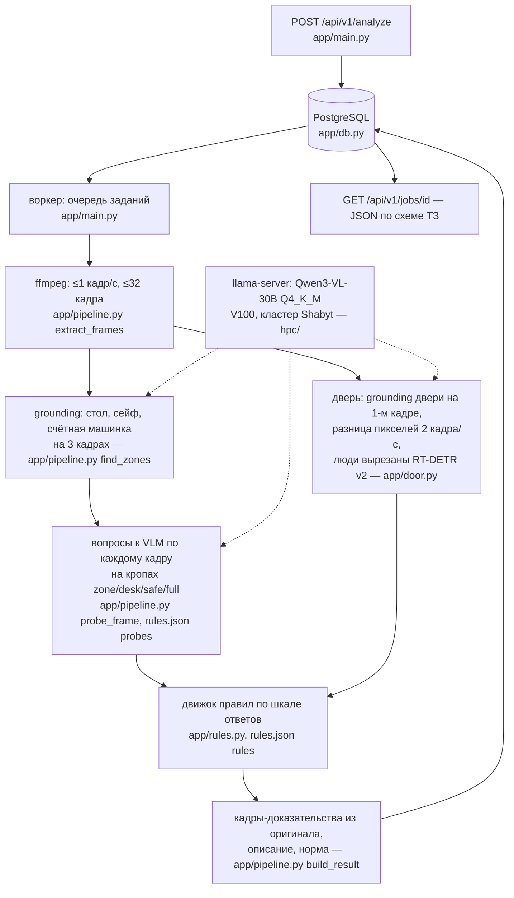

# Отчёт о состоянии проекта: контроль кассовой дисциплины по видео

Состояние на 18.10.2026, ветка `tracking` (= `main` 34217a5 + модуль трекинга). Все цифры ниже —
из прогонов 18.10.2026, сырые результаты в [docs/results/](results/). Чего нет в коде или не
измерено — так и написано.

## 1. Задача и подход

Сервис принимает видео (.mov) с камеры над кассой и возвращает вердикт «нарушение / нет», а для
каждого нарушения — тип, таймкод, 1–3 кадра-доказательства (JPEG base64), описание увиденного и
норму (документ, пункт, ссылка на adilet.zan.kz). Ключевая идея: локальная VLM (Qwen3-VL-30B)
не выносит вердикт, а отвечает на короткие вопросы «да/нет» и «выбор из вариантов» про отдельные
кадры и их кропы (стол, сейф, вся зона); вердикт, тип и таймкод выводит детерминированный движок
правил по временной шкале ответов, а норму берёт из `rules.json`. Дверь проверяется без модели —
по разнице пикселей.

## 2. Архитектура

| Этап | Файл | Что делает (по коду) |
|---|---|---|
| Приём и очередь | `app/main.py`, `app/db.py` | `POST /api/v1/analyze` сохраняет видео и задание в PostgreSQL; фоновый воркер берёт задания по одному (`db.claim_run`), незавершённые после перезапуска возвращаются в очередь (`db.requeue_unfinished`) |
| Нарезка кадров | `app/pipeline.py` `sample_step`, `extract_frames` | шаг 1/`FRAME_FPS` (1 кадр/с), но не больше `MAX_FRAMES` = 32 кадров на видео: длинные видео прореживаются равномерно |
| Порядок обработки | `app/pipeline.py` `coarse_to_fine` | сначала каждый 2-й кадр, затем остальные: при нехватке времени пропадают промежуточные кадры, а не конец видео |
| Зоны | `app/pipeline.py` `find_zones` | модель находит рамки «cashier desk», «metal safe», «banknote counting machine» на 3 кадрах (начало, середина, конец); зона кассира = объединение рамок с отступами; если ничего не найдено — весь кадр, вопросы по сейфу пропускаются |
| Вопросы к модели | `app/pipeline.py` `probe_frame`, `rules.json` `probes` | 13 вопросов; у каждого кроп (`zone` / `desk` / `safe` / `full`), условие `when` (задаётся, только если ответ на другой вопрос такой-то), частота `every`; ответы кэшируются по хешу кропа + вопроса + модели |
| Дверь | `app/door.py` | grounding двери на первом кадре; ffmpeg 2 кадра/с; выравнивание по первому кадру (ECC); люди вырезаются детектором RT-DETR v2; доля изменившихся пикселей в рамке двери → сигнал |
| Правила | `app/rules.py`, `rules.json` `rules` | виды правил: `state` (условие держится ≥ `min_sec` и ≥ `min_frames` кадров), `missing_before` / `missing_after` (в визите посетителя было / не было события до / после триггера), `after_session` (после ухода посетителя), `signal` (сигнал двери выше порога ≥ `min_sec`) |
| Результат | `app/pipeline.py` `build_result`, `describe` | кадры-доказательства вырезаются ffmpeg из оригинала в моменты события; описание = наблюдение из `rules.json` + время + обоснование + норма; если норма не помечена `verified` — «Норматив уточняется» |
| Бюджет времени | `app/config.py` `TIME_BUDGET_SEC` = 270 | после 270 с анализ кадров останавливается и отдаётся найденное (лимит жюри 300 с) |
| Модель | `app/vlm.py` | OpenAI-совместимый клиент к llama-server; `FailoverBackend` — основной и запасной сервер, переключение и посреди видео |
| Трекинг (ветка `tracking`, в сервис **не подключён**) | `pipeline/`, `config/tracking.yaml` | RT-DETR r50 + ByteTrack 5 кадров/с, зона кассира, события ухода/входа; см. раздел 13 |

## 3. Модели и библиотеки

Лицензии проверены 18.10.2026: модели — по API Hugging Face (`cardData.license`), Python-пакеты —
по метаданным установленных пакетов и PyPI, npm-пакеты — по registry.npmjs.org, llama.cpp — по файлу LICENSE.

| Название | Версия / чекпойнт | Для чего | Лицензия | Размер | GPU |
|---|---|---|---|---|---|
| Qwen3-VL-30B-A3B-Instruct | `Qwen/Qwen3-VL-30B-A3B-Instruct-GGUF`: `Qwen3VL-30B-A3B-Instruct-Q4_K_M.gguf` + `mmproj-Qwen3VL-30B-A3B-Instruct-Q8_0.gguf` (`hpc/setup.sh`) | все вопросы к кадрам, grounding зон и двери | Apache-2.0 (и исходная модель, и GGUF-репозиторий) | 18 556 687 168 + 712 148 928 байт (18,6 + 0,7 ГБ) | V100-PCIE-32GB; llama-server с 4 слотами, контекст 32 768 — 22 300 МиБ (замер `nvidia-smi` 18.10) |
| Qwen3-VL-8B-Instruct (запасная) | по `docs/solution.md` и `scripts/serve.sh` — на ноутбуке команды (M1 Pro); квантизация и версия сервера **мной не проверены** | то же при недоступности основной | Apache-2.0 | не измерено | не измерено |
| llama.cpp `llama-server` | тег `b11669` (`hpc/setup.sh`), в логе сервера `0.7.0-dev (build 1, commit 620d222)` | сервер модели, OpenAI-совместимый API | MIT | — | CUDA 12.6, sm_70 |
| RT-DETR v2 r18vd | `PekingU/rtdetr_v2_r18vd` (`app/door.py`) | вырезать людей из сравнения пикселей двери | Apache-2.0 | 75 МБ (кэш HF) | процесс пайплайна с детектором — 642 МиБ (замер 18.10) |
| RT-DETR r50vd | `PekingU/rtdetr_r50vd` (ветка `tracking`) | детекция людей для трекинга | Apache-2.0 | 159 МБ (кэш HF), 42 млн параметров | ~50 мс/кадр на V100 |
| supervision | 0.30.9 (ветка `tracking`) | ByteTrack | MIT | — | — |
| torch | 2.14.1+cu126 (окружение прогонов на кластере) | детекторы | BSD-3 и др. (метаданные: Apache-2.0, BSD-2/3, BSL-1.0, MIT) | — | CUDA 12.6 |
| transformers | 5.20.1 (окружение прогонов) | загрузка RT-DETR | Apache-2.0 | — | — |
| opencv-python-headless | 5.0.0.93 | выравнивание кадров двери (ECC), чтение кадров трекинга | Apache-2.0 | — | — |
| Pillow | 13.0.0 | кропы | MIT-CMU | — | — |
| httpx | 0.28.1 | клиент модели | BSD-3-Clause | — | — |
| FastAPI / uvicorn / python-multipart | `requirements.txt`: fastapi ≥ 0.115, uvicorn ≥ 0.30, python-multipart ≥ 0.0.9 | API | MIT / BSD-3-Clause / Apache-2.0 | — | — |
| psycopg | `requirements.txt`: ≥ 3.2, < 4 | драйвер PostgreSQL | **LGPL-3.0-only** (используется как библиотека без изменений) | — | — |
| PostgreSQL | образ `postgres:17` (`compose.yaml`) | задания, результаты, работники | PostgreSQL License | — | — |
| ffmpeg / ffprobe | системный (сервис); на кластере модуль `FFmpeg/7.0.2` | нарезка кадров, кадры-доказательства | LGPL/GPL в зависимости от сборки; сборка на машине деплоя **не проверена** | — | — |
| Фронт | react / react-dom 19, lucide-react, motion, vite 8, typescript 7, oxlint (`front/package.json`) | интерфейс | MIT; lucide-react — ISC; typescript — Apache-2.0 | — | — |

Ultralytics и другие AGPL-библиотеки в зависимостях отсутствуют (`requirements.txt`, `requirements-tracking.txt`, `front/package.json`).

## 4. Роль VLM

**Модель:** Qwen3-VL-30B-A3B-Instruct, Q4_K_M, llama.cpp на V100 (кластер НУ Shabyt); запасная —
Qwen3-VL-8B. Параметры запроса (`app/vlm.py`): `temperature: 0`; для «да/нет» `max_tokens: 4`;
для выбора варианта — 3; для рамки — 40.

**Системный промпт** (каждый запрос):
> You look at a frame from an overhead CCTV camera in a bank cashier room. Answer only from what is clearly visible, never guess. Do not identify people.

**Вопрос «да/нет»** = текст вопроса + ` Answer with one word: yes or no.`
**Вопрос с выбором** = `{вопрос} A) {вариант 1} B) {вариант 2} … Answer with one letter.`
**Поиск рамки** (зоны: «cashier desk», «metal safe», «banknote counting machine»; дверь: «glass door of the room», «door»):
> Locate the {label} in the image. Output only JSON {"bbox_2d": [x1, y1, x2, y2]}, or {"bbox_2d": []} if it is not visible.

**Вопросы по кадрам** (`rules.json`, дословно):

| id | Кроп | Условие | Вопрос |
|---|---|---|---|
| cashier_seated | zone | — | Is a person sitting in the chair at the cashier desk, on the employee side next to the laptop and the counting machine? |
| safe_open | zone | — | Is the door of the grey metal safe (cabinet) open? |
| cash_on_desk | zone | — | Are banknotes, a bundle of cash or a cash bag lying on the desk (not held in someone's hand)? |
| eating_now | zone | каждый 2-й кадр | Is the employee drinking or eating right now (a cup, bottle or food raised to the mouth)? |
| personal_items | zone | каждый 2-й кадр | Is a coat, jacket, scarf or a personal handbag or backpack lying on the desk? Office equipment (counting machine, laptop, phone, printer), banknotes, documents and a green cash-collection bag do not count. |
| visitor | zone | — | Besides the employee at the desk, is there another person (a visitor) in the picture? |
| crowd | zone | visitor = yes | Are there three or more people in the picture? |
| cash_handover | zone | visitor = yes | Is one person passing banknotes or a bag to another person across the desk right now? |
| screen_unlocked | zone | cashier_seated = no | Does the laptop screen show an open program, document or spreadsheet (not black and not a lock screen with a picture)? |
| cash_in_machine | zone | — | Are banknotes inside or being fed into the banknote counting machine right now? |
| held_object | desk | visitor = yes | Look at the hands of the people at the desk. What is someone holding up, showing or passing across the desk right now? Tell them apart carefully: banknotes are several thin paper bills (blue, green, beige or orange), often fanned out, stacked or counted; an ID card is ONE small stiff white plastic card with a photo, held flat and shown. — варианты: nothing in hands / banknotes / an ID card / a green cash-collection bag / a phone / something else |
| person_in_room | full | cashier_seated = no | Is any person visible in the room? |
| key_in_safe | safe | cashier_seated = no | Is a key sticking out of the lock on the safe door? |

**На каких кадрах:** до 32 кадров на видео (1 кадр/с, длинные прореживаются), в порядке «сначала
каждый второй»; grounding зон — на 3 кадрах; grounding двери — на первом кадре.

**Чего VLM не делает:** не выносит вердикт и не выбирает тип (это `app/rules.py` по ответам);
не пишет ссылки на нормы (норма — из `rules.json`, в описании только при `verified: true`); не
ставит таймкод (таймкод — время кадра, с которого началось событие в движке правил); не решает,
открыта ли дверь (`app/door.py`, разница пикселей); не распознаёт людей (в промпте «Do not identify
people», детекторы выдают только рамку класса person).

## 5. Типы нарушений

Таймкод (по `app/rules.py`): `state` — время первого кадра серии, где условие выполнено;
`missing_before` / `missing_after` — кадр-триггер (передача денег или сумки); `after_session` —
первый кадр пересчёта после ухода посетителя; `signal` — начало изменения в рамке двери.
Ролики — по `docs/labels_types.csv` (разметка команды + разбор).

| Тип (`rules.json`) | Логика | Норма (`rules.json`, дословно) | Ролики датасета |
|---|---|---|---|
| Наличные оставлены без присмотра | cash_on_desk = yes и cashier_seated = no ≥ 2 с | Правила осуществления кассовых операций… (постановление Правления НБРК от 29.11.2019 № 231), п. 20, абз. 2 | Х-15, Х-26 |
| Наличные открыто на рабочем месте | cash_on_desk = yes и cashier_seated = yes ≥ 8 с | там же, п. 20, абз. 2 | Х-4, Х-38, Х-46 |
| Сейф оставлен открытым | safe_open = yes и cashier_seated = yes ≥ 5 с; или safe_open = yes и person_in_room = no ≥ 2 с | там же, п. 20, абз. 2 | Х-20 |
| Ключ оставлен в замке сейфа | key_in_safe = yes и cashier_seated = no ≥ 2 с (кроп сейфа) | там же, п. 80 | Х-22 |
| Рабочая станция не заблокирована при уходе | screen_unlocked = yes и cashier_seated = no ≥ 2 с | Требования к обеспечению информационной безопасности банков… (постановление Правления НБРК от 27.03.2018 № 48), п. 71, пп. 9 (смежная норма — так и написано в обосновании) | Х-11, Х-28 |
| Приём инкассаторской сумки без проверки документов | в визите посетителя: передача + в руках сумка; удостоверения не было ни разу за визит | Правила № 231, п. 24 | Х-17 |
| Посторонний в кассовом помещении | crowd = yes ≥ 2 с | Правила организации охраны и устройства помещений банков второго уровня… (рег. № 20075), п. 8, п. 16 пп. 1 | Х-18 |
| Дверь кассы оставлена открытой | сигнал двери ≥ 0,1 не меньше 8 с, сдвиг кадра ≤ 4 px | там же (рег. № 20075), п. 8, п. 16 пп. 1 | Х-30, Х-32, Х-33 |
| Личные вещи на рабочем месте кассира | personal_items = yes ≥ 3 с | Правила № 231, п. 12 | Х-40 |
| Наличные приняты без пересчёта на оборудовании | передача купюр, затем в течение визита (+5 с) cash_in_machine ни разу не yes | Правила № 231, п. 19, пп. 2; п. 41 | Х-47 |
| Пересчёт наличных в отсутствие клиента | после визита с передачей: visitor = no и cash_in_machine = yes ≥ 2 кадров в течение 10 с | Правила № 231, п. 20, абз. 1 | Х-34 |

**Выключены** (поле `disabled_reason` в `rules.json`): приём наличных без удостоверения (п. 19
пп. 1) — «0 попаданий и 4 ложных»; открытый сейф при посетителе — «9 ложных из 19 чистых»; еда на
рабочем месте (п. 12) — «0 попаданий».

**Нет правила** для типов из разметки: рабочие вещи на столе (Х-24), проверка ультрафиолетом
(Х-44); тип не установлен в разметке: Х-1, Х-2, Х-13.

## 6. Нормативная база

| Код | Документ | Ссылка | Редакция (docs/norms.md) |
|---|---|---|---|
| П231 | Правила осуществления кассовых операций и операций по инкассации банкнот, монет и ценностей в банках второго уровня… (постановление Правления НБРК от 29.11.2019 № 231) | https://adilet.zan.kz/rus/docs/V1900019680 | с изменениями на 12.07.2026 |
| ПОХР | Правила организации охраны и устройства помещений банков второго уровня… (рег. № 20075) | https://adilet.zan.kz/rus/docs/V2000020075 | с изменениями на 24.12.2024 |
| ТИБ48 | Требования к обеспечению информационной безопасности банков… (постановление Правления НБРК от 27.03.2018 № 48) | https://adilet.zan.kz/rus/docs/V1800016772 | с изменениями на 03.04.2026 |

**Сверка** (по `docs/norms.md`): тексты сверены по зеркалу zakon.uchet.kz («повторяет ИПС
Әділет»; adilet.zan.kz 17.10 отдавал ботам заглушку). П231 дополнительно сверены с официальной
PDF-выгрузкой ИЗПИ с adilet от 17.10.2026: пп. 12, 19, 20, 21, 22, 24, 74, 80 совпадают дословно.
Ручное открытие каждой ссылки на adilet.zan.kz в `norms.md` записано как требование «перед
сдачей»; отметки о том, что оно выполнено, в репозитории нет. Все нормы в `rules.json` помечены
`verified: true`. Связь «трактовка» прямо указана в обосновании правил (посторонний, экран — «смежная норма»).

Сопоставление правил с видео: правило → поле `source` в `rules.json` → в ответ API попадают
документ и пункт; в описании — наблюдение, обоснование и норма (`app/pipeline.py describe`).

## 7. Метрики на обучающих роликах

Прогон 18.10.2026: `scripts/eval.py` по всем 42 роликам датасета, правила и вопросы — текущий `main`
(34217a5), модель Qwen3-VL-30B Q4_K_M на V100, `VLM_PARALLEL=4`. Сырые результаты:
[results/eval_main/](results/eval_main/) (JSON на ролик с шкалой ответов), лог —
[results/eval_main.log](results/eval_main.log), таблица — [results/metrics_main.md](results/metrics_main.md)
(`scripts/report_metrics.py`).

**Пороги и правила подбирались на этих же 42 роликах** (`docs/run_review.md`), отложенной выборки
нет — на новых видео результат, скорее всего, ниже.

| Метрика | Значение |
|---|---|
| Вердикт | TP 16, FP 10, TN 10, FN 6 |
| Accuracy | 61,9 % (26/42) |
| Recall по нарушениям | 72,7 % (16/22) |
| Precision | 61,5 % (16/26) |
| Таймкод (16 верно найденных) | \|ошибка\| медиана 6,6 с, максимум 11,2 с; в пределах ±2 с — 4/16 |
| Тип | 12/19 верно (ролики с нарушением и известным типом; логика `scripts/eval.py`) |

**Расхождение с `docs/solution.md`:** там указано 32/42 (пропусков 2, ложных 8). Те цифры получены
пересчётом правил по ответам модели, сохранённым в более ранних прогонах (`eval_30b_v2/`, в
репозитории их нет). Этот прогон — свежий, с нуля; причины расхождения не исследованы. Видно, что
10 ложных из них 5 — правило «экран не заблокирован» на чистых роликах (Х-23, 25, 27, 29 и Х-14),
а сейф в Х-20 в этот раз не найден.

Таблица по роликам (таймкод — ближайший к метке; «тип» — совпал ли тип хотя бы одного события):

| Ролик | Разметка | Ответ сервиса | Ошибка таймкода, с | Тип | Вердикт |
|---|---|---|---|---|---|
| Х-1 | нарушение @22 с | нет нарушений | — | тип в разметке не установлен | **пропуск** |
| Х-2 | нарушение @10 с | нет нарушений | — | тип в разметке не установлен | **пропуск** |
| Х-3 | чисто | нет нарушений | — | — | верно |
| Х-4 | нарушение @57 с | 13.6 с Рабочая станция не заблокирована при уходе; 43.2 с Рабочая станция не заблокирована при уходе; 56.8 с Наличные открыто на рабочем месте | 0.2 | верно (cash_on_desk) | верно |
| Х-5 | чисто | нет нарушений | — | — | верно |
| Х-8 | чисто | нет нарушений | — | — | верно |
| Х-10 | чисто | 0 с Наличные открыто на рабочем месте | — | — | **ложное** |
| Х-11 | нарушение @18 с | 11.8 с Рабочая станция не заблокирована при уходе | 6.2 | верно (screen_unlocked) | верно |
| Х-12 | чисто | нет нарушений | — | — | верно |
| Х-13 | нарушение @47 с | 0 с Рабочая станция не заблокирована при уходе; 38.8 с Наличные оставлены без присмотра | 8.2 | тип в разметке не установлен | верно |
| Х-14 | чисто | 31.2 с Наличные оставлены без присмотра; 35.6 с Рабочая станция не заблокирована при уходе; 44.5 с Наличные открыто на рабочем месте; 71.3 с Наличные открыто на рабочем месте; 102.5 с Наличные открыто на рабочем месте; 115.8 с Сейф оставлен открытым | — | — | **ложное** |
| Х-15 | нарушение @15 с | 0 с Личные вещи на рабочем месте кассира; 8 с Рабочая станция не заблокирована при уходе | 7.0 | неверно (cash_on_desk) | верно |
| Х-16 | чисто | нет нарушений | — | — | верно |
| Х-17 | нарушение @7 с | 3.9 с Приём инкассаторской сумки без проверки документов; 9.8 с Личные вещи на рабочем месте кассира | 2.8 | верно (bag_no_doc) | верно |
| Х-18 | нарушение @20 с | 15.7 с Посторонний в кассовом помещении | 4.3 | верно (extra_person) | верно |
| Х-19 | чисто | 53.8 с Посторонний в кассовом помещении | — | — | **ложное** |
| Х-20 | нарушение @5 с | нет нарушений | — | неверно (safe_open) | **пропуск** |
| Х-21 | чисто | нет нарушений | — | — | верно |
| Х-22 | нарушение @14 с | 6.7 с Рабочая станция не заблокирована при уходе | 7.3 | неверно (key_in_safe) | верно |
| Х-23 | чисто | 5.8 с Рабочая станция не заблокирована при уходе | — | — | **ложное** |
| Х-24 | нарушение @8 с | нет нарушений | — | неверно (items_left) | **пропуск** |
| Х-25 | чисто | 5 с Рабочая станция не заблокирована при уходе | — | — | **ложное** |
| Х-26 | нарушение @9 с | 9.9 с Наличные оставлены без присмотра | 0.9 | верно (cash_on_desk) | верно |
| Х-27 | чисто | 13.7 с Рабочая станция не заблокирована при уходе | — | — | **ложное** |
| Х-28 | нарушение @7 с | 6.8 с Рабочая станция не заблокирована при уходе | 0.2 | верно (screen_unlocked) | верно |
| Х-29 | чисто | 6.7 с Рабочая станция не заблокирована при уходе | — | — | **ложное** |
| Х-30 | нарушение @13 с | 2.5 с Дверь кассы оставлена открытой | 10.5 | верно (door_open) | верно |
| Х-31 | чисто | нет нарушений | — | — | верно |
| Х-32 | нарушение @5 с | 5.5 с Дверь кассы оставлена открытой | 0.5 | верно (door_open) | верно |
| Х-33 | нарушение @6 с | 3.5 с Дверь кассы оставлена открытой | 2.5 | верно (door_open) | верно |
| Х-34 | нарушение @13 с | нет нарушений | — | неверно (count_without_client) | **пропуск** |
| Х-35 | чисто | 40.8 с Сейф оставлен открытым | — | — | **ложное** |
| Х-37 | чисто | нет нарушений | — | — | верно |
| Х-38 | нарушение @33 с | 24 с Наличные открыто на рабочем месте; 44.2 с Посторонний в кассовом помещении | 9.0 | верно (cash_on_desk) | верно |
| Х-39 | чисто | нет нарушений | — | — | верно |
| Х-40 | нарушение @17 с | 7.8 с Личные вещи на рабочем месте кассира | 9.2 | верно (personal_items) | верно |
| Х-43 | чисто | 13.6 с Наличные открыто на рабочем месте | — | — | **ложное** |
| Х-44 | нарушение @16 с | нет нарушений | — | неверно (uv_not_checked) | **пропуск** |
| Х-45 | чисто | 9.4 с Наличные открыто на рабочем месте; 14.6 с Пересчёт наличных в отсутствие клиента | — | — | **ложное** |
| Х-46 | нарушение @11 с | 3.8 с Наличные открыто на рабочем месте | 7.2 | верно (cash_on_desk) | верно |
| Х-47 | нарушение @68 с | 13.6 с Рабочая станция не заблокирована при уходе; 43.2 с Рабочая станция не заблокирована при уходе; 56.8 с Наличные открыто на рабочем месте | 11.2 | неверно (not_machine_counted) | верно |
| Х-48 | чисто | нет нарушений | — | — | верно |

## 8. Устойчивость к ракурсу

**Сделано в коде:** нет фиксированных координат — зона кассира, стол, сейф и дверь находятся
grounding-запросами к модели на каждом видео заново (`find_zones`, `door.find_door`); дверь
сравнивается с первым кадром после выравнивания (ECC), при сдвиге кадра > 4 px правило двери не
применяется (камера с рук). Трекинг (ветка `tracking`) строит зону от рамки кассира в этом же ролике.

**Проверка на своих съёмках:** `docs/run_review.md` сообщает 8/13 на 13 своих роликах (другая
комната и ракурс, камера с рук). **В этом отчёте не перепроверено:** этих роликов у меня нет.
Финальное видео жюри будет снято под другим углом — на нём не проверялось.

## 9. Производительность

**Время анализа ролика** (`_debug.seconds` прогона из раздела 7, функция `analyze_video` без
загрузки и очереди; V100-PCIE-32GB, llama-server с 4 слотами, `VLM_PARALLEL=4`, запросы к модели
внутри узла кластера, без SSH-туннеля): медиана 82 с, максимум 151 с — самый длинный ролик Х-14
(143 с видео, проанализированы все 32 кадра). Это в пределах `TIME_BUDGET_SEC` = 270 с и лимита 300 с.

**Память GPU** (замер `nvidia-smi` во время прогона, мгновенное значение, а не пик за весь прогон):
llama-server — 22 300 МиБ, процесс пайплайна с детектором двери — 642 МиБ; всего 22 946 из 32 768 МиБ.

**End-to-end через API** (от POST до `status=done`): ⏳ замер после прогона, см. ниже.

**Трекинг** (ветка `tracking`, в сервис не подключён): ~50 мс/кадр на V100 при 5 кадрах/с — ~35 с на ролик 145 с.

## 10. Продукт

**Интерфейс** (`front/`, React + Vite, отдаётся сервисом на `/`): список расследований (поиск,
удаление записи), загрузка видео и запуск анализа («Video Analysis»), карточка случая с событиями
и решением проверяющего («Review decision»), справочник работников («Employees», добавление,
профиль, «Performance index»). Живой просмотр анализа — `/live` (`app/static`).

**API** (`app/main.py`): по ТЗ — `POST /api/v1/analyze` (поле `file`, .mov/.mp4/.m4v, до
`MAX_UPLOAD_MB` = 200 МБ) → `{"job_id", "status"}`; `GET /api/v1/jobs/{job_id}` → `processing`
(со стадией и прогрессом) / `done` (результат по схеме ТЗ) / `failed`. Дополнительно: работники
(`/api/v1/workers…`), видео (`/api/v1/videos…`: список, карточка, события, кадры, поток, постер),
`/health`. **Авторизация:** заголовок `X-API-Key` (ключ жюри) либо подписанная cookie сессии
интерфейса; без них — 401. Поток и постер — по подписанной ссылке.

**Деплой** (`scripts/serve.sh`, `scripts/public_url.sh`, `hpc/`): PostgreSQL 17 в docker,
uvicorn на 127.0.0.1:8000, публичный адрес — туннель pinggy (SSH на порт 443); модель — llama-server
на кластере Shabyt через SSH-туннель, запасная — на ноутбуке команды. Публичный адрес хранится на
машине деплоя (`~/.dalel_public_url`), в репозитории его нет. Запуск: `README.md`, `docs/solution.md` (раздел «Запуск»).

## 11. Соответствие ограничениям ТЗ

| Требование | Чем подтверждается |
|---|---|
| Нет облачных AI-вызовов | `app/vlm.py` `assert_local_url`: адрес модели должен разрешаться в loopback / частную сеть / link-local, иначе `VLMError` и кадры не отправляются. Других внешних API в коде нет (поиск по `requirements.txt` и `app/`: нет openai/anthropic/google SDK) |
| Работа без интернета после загрузки весов | веса Qwen — локальные GGUF-файлы; RT-DETR — кэш HF. Прогоны 18.10 шли с `HF_HUB_OFFLINE=1` (детектор двери и трекинга загрузились из кэша). Сам сервис `HF_HUB_OFFLINE` не выставляет: при недоступном интернете transformers берёт кэш, но поведение без сети для `app/door.py` на машине деплоя **не проверено** |
| Лицензии с коммерческим использованием | раздел 3; Ultralytics/AGPL не используются; psycopg — LGPL-3.0 (как библиотека) |
| Нет распознавания лиц | моделей лиц нет; детекторы — только рамки класса person (`app/door.py`, `pipeline/tracking.py`); системный промпт VLM: «Do not identify people» |
| Звук не используется | ffmpeg берёт только видеопоток (`-vf fps=…`, кадры), аудио нигде не читается |
| Не утверждать то, чего не видно | правила только по видимым признакам; для неподтверждённой нормы — «Норматив уточняется, результат требует проверки человеком» (`app/pipeline.py`) |
| Лимит 5 минут | `TIME_BUDGET_SEC` = 270 с: после него отдаётся найденное; фактическое время — раздел 9 |

## 12. Ограничения и известные ошибки

По прогону из раздела 7:

| Ошибка | Ролики | Причина (по ответам в results/eval_main и docs) |
|---|---|---|
| Пропуск: тип не установлен | Х-1, Х-2 | в разметке тип не указан, правил под эти сценарии нет |
| Пропуск: сейф открыт | Х-20 | в этом прогоне правило сейфа не набрало 5 с при сидящем кассире |
| Пропуск: рабочие вещи на столе | Х-24 | правила нет (планшет — не «наличные» и не «личные вещи») |
| Пропуск: пересчёт без клиента | Х-34 | сценарное правило не сработало: визит/пересчёт распознаются ненадёжно |
| Пропуск: проверка ультрафиолетом | Х-44 | правила нет |
| Ложное: «экран не заблокирован» | Х-23, Х-25, Х-27, Х-29, Х-14 | кассир правильно уходит с заблокированным экраном; модель плохо отличает экран блокировки от программы, правило ждёт «кассир не за столом» |
| Ложное: деньги на столе | Х-10, Х-14, Х-43, Х-45 | кассир работает с деньгами при клиенте; по кадрам «работает» и «оставил» модель не различает |
| Ложное: сейф открыт | Х-14, Х-35 | кассир работает рядом с открытым сейфом |
| Ложное: посторонний | Х-19 | «3+ человека» на одном визите |
| Ложное: пересчёт без клиента | Х-45 | визит/пересчёт распознаются ненадёжно |
| Тип неверный при верном вердикте | Х-15, Х-22, Х-47 | Х-22 пойман как «экран», а не «ключ»; Х-47 — «деньги на столе» вместо «без пересчёта» |
| Таймкод | 12 из 16 верно найденных > 2 с | ≤ 32 кадров на видео (шаг > 1 с на длинных), событие засчитывается с первого кадра серии ответов |

Известные по коду и пробам:
- ключ в замке сейфа (Х-22): на кадре 464×848 сейф ~80×110 пикселей, ключ — около 4; модель его не видит (пробы 17–18.10, `scripts/probe_vlm.py` в ветке `probe-presence-rules`);
- дверь, открытая с первого кадра, не детектируется (опорный кадр — первый); при камере с рук правило двери отключается;
- удостоверение личности распознаётся ненадёжно — правило «без документа» выключено;
- ответы модели при параллельных запросах недетерминированы: повторный прогон даёт другие ошибки (сравнение с `docs/solution.md` в разделе 7).

## 13. Что не успели и как развивать

- **Трекинг людей не подключён к сервису** (ветка `tracking`, `docs/tracking.md`). Измерено 18.10
  на тех же 42 роликах: связка «уход кассира по трекингу → 4 вопроса Qwen» — 4/22 нарушений, 0/20
  ложных ([results/tracking_vlm.json](results/tracking_vlm.json)). Пересчёт прогона из раздела 7
  с трекингом ([results/rescore_tracking_gate.txt](results/rescore_tracking_gate.txt)):

  | Вариант | Верный вердикт | Пропуски | Ложные | Тип |
  |---|---|---|---|---|
  | main как есть | 26/42 | 6 | 10 | 12/19 |
  | экран только при уходе по трекингу | 27/42 | 8 | 7 | 11/19 |
  | + нарушения связки «уход → Qwen» | 29/42 | 6 | 7 | 11/19 |

  Это пересчёт на тех же роликах, где подбирались правила. Дальше: вопросы о людях (`visitor`,
  `person_in_room`) заменить трекингом; выбирать кадры для VLM вокруг событий, а не равномерно.
- Таймкод «оставил и ушёл» по трекингу позже метки на 3–9 с (момент выхода, а не действия).
- Устойчивость к ракурсу не измерена на видео жюри.
